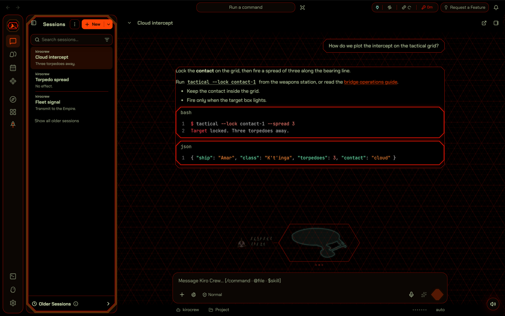
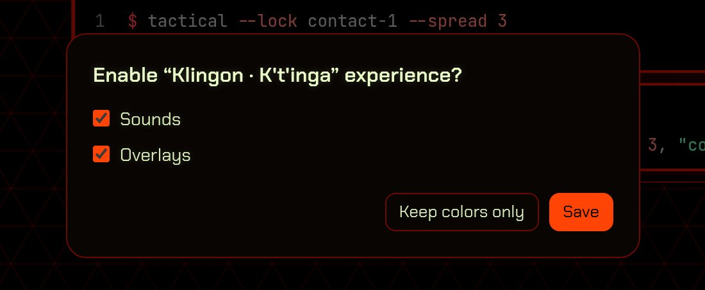

# Kiro Crew theme: Klingon · K't'inga

An unofficial Kiro Crew theme modeled on the bridge of the Klingon K't'inga-class battle cruisers in *Star Trek: The Motion Picture* (1979), the film's opening battle with V'Ger.

- **Look:** the bridge's tactical display. Black glass in a dim amber-brown housing with cut corners, the viewscreen's faint two-level red triangle lattice behind the chat (thin lines with dotted nodes, a brighter line on every fourth), pale glyph-coloured text, the orange of the ship symbol as the accent, the cyan-white of the contact for success, red for errors.
- **Thinking indicator:** three red torpedoes lighting in turn inside the grid.
- **Welcome mark:** the Klingon Empire emblem as the films show it, black prongs edged in gold on a pale disc ringed in gold, with the Klingon phrase *Qapla'!* ("Success!") under it. The emblem is traced from *Star Trek VI*; no frame of *The Motion Picture* shows it.
- **Screensaver:** after 15 minutes with no key press, click, scroll or touch, the tactical display fills the screen: the red lattice inside its hexagon, the orange ship symbol in a blinking target box, a cyan-white contact closing in, torpedoes leaving the ship, rows of glyphs that change, and *Qapla'!* above the grid. Press a key or click to dismiss it; the click does not reach the app. The dashboard's nav, session list and chat header stay on top, so the display fills the area to their right. It does not run when the OS is set to reduce motion, and it stops after 30 minutes.
- **Tracking display:** behind the chat, the K't'inga's screen tracks the Federation ships of the film: the refit Enterprise and the long-range shuttle Surak, outlines traced from frames of *The Motion Picture*, in the cyan-white of the display's contact. One ship at a time crosses slowly; a red box in the shape of the display's hexagon closes on it and blinks three times as it locks, three red lights step under it, and the Klingon emblem and two rows of glyphs sit beside it. Then the screen stays empty for half a minute or more. It is dim enough that body and muted text keep their contrast, takes no clicks, draws 20 frames a second while a ship is in view and nothing between ships, and pauses while the tab is hidden. When the OS asks for reduced motion, the chat shows one still frame of it instead.
- **Desktop splash:** while the desktop app waits for its gateway, the same display in its housing, with the app's name under the grid and *Qapla'!* above it. It holds still when the OS asks for reduced motion.
- **Code:** code blocks, diffs and the file viewer use the `synthwave-84` scheme (red, cyan, pink and yellow) in both modes.
- **Light mode:** the same as dark. The films have no light screens.
- **Type:** Chakra Petch, a free sans whose letters have cut corners, like the screen housings. The Klingon screens carry no Latin type, only Klingon glyphs, so there is no film face to match.
- **Shapes:** cut (bevelled) corners use CSS `corner-shape: bevel`, which Chrome, Edge and the desktop app draw. A browser without it shows rounded corners instead.
- **Glyphs:** the Klingon-style glyphs on the splash and the screensaver are original, made in code. They are decoration: they spell nothing, as the film graphics did not.
- **Sounds:** short, low console tones when the theme turns on or off, when a reply arrives, on notifications, and when an approval waits. Original sounds made in code, shaped after the 1979 film's electronic effects: warbling square-wave tones and falling two-note calls. None is taken from the film. They stay silent under reduced motion and while sounds are muted.

The first time you pick this theme, Kiro Crew asks which parts to turn on: Sounds, and Overlays (the tracking display and the screensaver). Change either later under Settings → Display → Theme → Experience.

Needs Kiro Crew 0.13.0 or newer; older versions refuse the pack.

Pick System under Settings → Display → Font Family to keep the OS font.

| Chat | Tracking display | Screensaver | Desktop splash | Welcome mark | First pick |
|---|---|---|---|---|---|
|  |  |  |  |  |  |

## The two Klingon packs

| Repo | Films |
|---|---|
| This one | *Star Trek: The Motion Picture* (1979) |
| [kirocrew-theme-klingon-bird-of-prey](https://github.com/leozhad/kirocrew-theme-klingon-bird-of-prey) | *Star Trek III to VI* (1984 to 1991) |

## Install

1. Open Settings → Display → Theme.
2. Under **Install Theme**, choose **GitHub** and paste `https://github.com/leozhad/kirocrew-theme-klingon-k-tinga`.
3. Install, then pick **Klingon · K't'inga** in the Theme list.

To update, install the same URL again.

From a browser that is not on the gateway's machine (a phone, say), use a zip instead: on GitHub choose **Code → Download ZIP**, then in Install Theme set **Theme source** to **Zip file** and pick that file. Kiro Crew finds the pack inside the zip's one top-level folder.

## Use your own sounds

The sounds are WAV files in `audio/`, named in `audio/manifest.json`: `activate` and `deactivate` (the theme turns on or off), `received` (a reply arrives), `notify` (notifications) and `approval` (an approval waits). To play your own, clone or unzip this repo, replace any of those files with a sound of your own under the same name, and install that folder (**Local folder**) or a zip of it. Kiro Crew accepts WAV, MP3 or OGG; if you change the extension, change `src` in `audio/manifest.json` to match. Keep each file under 512 KB. Kiro Crew stops a sound after its `maxDuration` (at most 5 s for `activate`, 1 s for `received`, 2 s for the others). Do not edit the installed copy: reinstalling replaces it.

## Film evidence

Colours were measured on [TrekCore](https://movies.trekcore.com/gallery/) Blu-ray screencaps: the film's hue and saturation, with brightness set for contrast (body text at least 7:1, secondary text and status colours at least 4.5:1). The frames are not in this repo.

Source: theatrical 4K remaster Blu-ray (2021). Set: redesigned by Douglas Trumbull and Andrew Probert, built under art director John Vallone; graphics: Lee Cole, who credited Vallone with the edge-lit plastic displays ([Memory Alpha, K't'inga class](https://memory-alpha.fandom.com/wiki/K%27t%27inga_class)).

| Colour | Frame | What it is | Film hue, sat |
|---|---|---|---|
| lattice | 94 | the red triangle lattice of the tactical display | 4°, 0.98 |
| ship | 94 | the orange ship symbol at its centre | 15°, 0.98 |
| glyph | 94 | the pale glyph labels on the grid (near white; measured with a saturation floor of 15/255) | 84°, 0.21 |
| contact | 94 | the cyan-white hexagon contact | 165°, 0.38 |
| script | 50 | orange glyph text on the grid | 16°, 0.81 |
| bridge | 42 | the cyan-blue glyph screens on the bridge consoles | 207°, 0.86 |
| lamp | 91 | the orange ceiling lamps | 12°, 0.84 |
| housing | 94 | the dim amber-brown housing round the viewscreen (value floor 25/255) | 26°, 0.91 |

Shapes: the viewscreen housing is a wide rectangle with cut corners (50, 94). The grid is an elongated hexagon, pointed left and right (92, 94), made of equilateral triangles. The target box round the ship symbol is a smaller hexagon of the same shape (94). The contact is a hexagon with a rounded glow (94). Three torpedoes show as a row of red dots on the grid (58).

Ship symbol: the orange K't'inga symbol at the grid's centre (92), traced: the orange pixels thresholded, the outer contour taken with OpenCV and simplified to 1.2 px, 36 points, kept as vector data in units of the symbol's longer side. The frame itself is not stored.

Type: none. The screens carry only Klingon glyphs. The pack uses Chakra Petch, a free sans with cut-corner letters, chosen for the bevelled housings, not to match any film type.

Glyphs: the labels are rows of angular, blade-like symbols (50, 94). Memory Alpha says Michael Okuda has admitted that the Klingon screen graphics from *Star Trek IV* on are "randomly arranged symbols", based on the few writings in TOS and the first three films ([Memory Alpha, Klingonese](https://memory-alpha.fandom.com/wiki/Klingonese)). The pack's glyphs are original shapes in that spirit, made in code: two or three tapered wedges each, generated from a seed. None is traced from a frame, a font or pIqaD.

Emblem: not visible in this film. None shows on the K't'inga hulls (frames 18 to 28, 33, 34, 46, 47, 52 to 55, brightened; the dark marks on the command pod in 46 are hull lettering) or on the bridge (42, 50, 58, 91, 92, 94). Memory Alpha ([Klingon emblem](https://memory-alpha.fandom.com/wiki/Klingon_emblem)) says the K't'inga cruisers here carried a three-coloured emblem; no frame confirms it, so the pack draws the emblem from *Star Trek VI* (see "The emblem" below).

### The tracking display

Each pack's `overlays/ambient.html` is an animated background in the spirit of the Matrix packs' digital rain, drawn behind the chat: Federation ships crossing the screen as if tracked by the Klingon ship, era-true per pack, with outlines traced from the films (asked for on Nov 20, 2026).

#### What the films' Klingon screens show

The films do put Federation ships on Klingon targeting screens:

| Film, frame | Screen | What it shows |
|---|---|---|
| III, Chapter 7, 775 | Kruge's Bird-of-Prey monitor | the Enterprise as a cyan line-art front view over a lattice, pink glyphs under it |
| VI, Chapter 12, 1830, 1834, 1835 | Chang's targeting display | a red triangle lattice in an elongated hexagon, glyph columns on both sides, the Enterprise-A as an orange icon. A triangle of two slanted bars closes round it: orange in 1834, lit yellow in 1835, with a bar and two ticks under it |
| V, Chapter 5, 542, 543 | Klaa's targeting display | its target, the probe *Pioneer 10* ([Memory Alpha, Pioneer 10](https://memory-alpha.fandom.com/wiki/Pioneer_10)), and an amber bracket that closes on it (the screensaver uses these) |
| TMP, Chapter 1, 58, 92, 94 | the K't'inga's tactical display | a cyan-white contact (V'Ger); a red hexagon pointed at both ends that frames the Klingon ship's own orange symbol (94; absent in 92); three red dots on the grid in 58, which look to be the torpedoes in flight after the firing in 52 to 57 |

In *The Motion Picture* the K't'inga's screen tracks V'Ger, not a Federation ship: none of TrekCore's 113 frames of Chapter 1, the only chapter with Klingon screens, shows a Federation ship on one. Nothing on it closes on or locks a contact either: the hexagon frames the Klingon ship itself, and the contact sits outside it (94). So the K't'inga pack's lock is ours: the film's own Federation ships, in the screen's contact colour, inside a box in the shape of that hexagon, which closes and locks; and three red lights, in the dots' colour, that step under it.

The lit reticle's colour is measured on VI 1835 (the triangle's box, lit pixels, the method above): hue 48° to 49°, saturation 0.91 to 0.97. The build keeps it as `BP.lock` (49°, 0.97), and the source repo's frame check re-measures it.

#### Which ships, and why

| Pack | Ship | Why it fits | Traced from |
|---|---|---|---|
| K't'inga | the refit Enterprise (NCC-1701) | the film's starship, sent to intercept V'Ger after it destroys the K't'inga cruisers | TMP, Chapter 14, frame 626: on its way to V'Ger, three-quarter view from above |
| K't'inga | the long-range shuttle *Surak* | the Federation courier that brings Spock from Vulcan to the Enterprise ([Memory Alpha, Long range shuttle](https://memory-alpha.fandom.com/wiki/Long_range_shuttle)) | TMP, Chapter 13, frame 572: side view, bow right |
| Bird-of-Prey | the Enterprise, as Kruge's monitor drew it | Kruge's Bird-of-Prey attacks it in III ([Memory Alpha, USS Enterprise (NCC-1701)](https://memory-alpha.fandom.com/wiki/USS_Enterprise_(NCC-1701))); Klaa's pursues the Enterprise-A in V, Chang's attacks it in VI ([Memory Alpha, USS Enterprise (NCC-1701-A)](https://memory-alpha.fandom.com/wiki/USS_Enterprise_(NCC-1701-A))). The refit and the -A are the same design | III, Chapter 7, frame 775: the monitor's own line art |
| Bird-of-Prey | USS *Grissom* (NCC-638) | destroyed by Kruge's Bird-of-Prey over the Genesis planet ([Memory Alpha, USS Grissom (NCC-638)](https://memory-alpha.fandom.com/wiki/USS_Grissom_(NCC-638))) | III, Chapter 2, frame 233: over Genesis, end-on view |
| Bird-of-Prey | USS *Excelsior* (NCC-2000) | with the Enterprise-A, battles Chang's Bird-of-Prey at Khitomer ([Memory Alpha, USS Excelsior (NCC-2000)](https://memory-alpha.fandom.com/wiki/USS_Excelsior_(NCC-2000))) | VI, Chapter 1, frame 47: three-quarter front view, bow left |

Checked and not used: Epsilon IX (a station that tracks the Klingons, and does not cross a screen); the travel pod and work bees in TMP (too small to read as ships); the *Saratoga* in IV (no Klingon scene); TMP 611, 612 and 631 (the Enterprise head-on, which does not read as crossing); TMP 430 (Chapter 10, a three-quarter view from below: traced first, but at 155 to 230 px the edge-on saucer and the nacelles read weakly as the Enterprise; 626 shows the saucer from above). Chapters 4, 10, 11, 13, 14, 15, 25 and 27 were looked through for these; the *Excelsior*'s side view in VI 1764 (smeared by its jump to warp); the top-view schematics in III 181 and VI 1823 (Federation screens, not Klingon ones); Chang's orange Enterprise icon in VI 1834 (the reticle overlaps it, so it cannot be traced cleanly; Kruge's line art is the clean Klingon-screen Enterprise).

#### How the ships are traced

The same way as the K't'inga symbol and the emblem: vector data made by the source repo's tracer (OpenCV); the frames are not stored.

- **Space shots** (626, 572, 47): the lit hull against black space, thresholded on HSV value (15, 22 and 40 out of 255) inside a box round the ship, closed (a 13 px kernel for the *Surak*, so its painted dark bands do not cut notches; 9 and 5 px for the others), the largest part kept, smoothed with a Gaussian blur; the outer contour and the large holes (the open space between hull, pylons and nacelles) taken with OpenCV and simplified to 1.4 px. Smaller holes are filled.
- **The *Grissom*** (233) sits against a planet, so its pixels are a GrabCut segmentation of its box, gated on value 40 (the planet's night side is 25 to 49 next to the ship; at 60 the dark underside of the saucer dropped out and the saucer looked cut off from its pylons). Holes under 8,000 px² are filled.
- **Kruge's monitor** (775): every contour of the cyan pixels (hue 197° ± 16°, saturation and value floors 80 and 110), filled even-odd so the gaps between the lines stay open: the monitor's own line art. Stray specks outside the drawing (outer contours under 25 px²) are dropped.

The source repo's frame check fills each outline on its frame and compares it with the frame's lit ship pixels, using the tracer's own threshold, so it checks that the data is still the trace of that frame, not that the segmentation is right (that was checked by eye, outline over frame). IoU at trace time: 0.97 (Enterprise, 626), 0.92 (*Surak*), 0.91 (Kruge's Enterprise), 0.89 (*Grissom*, whose outline comes from GrabCut, not from that threshold) and 0.93 (*Excelsior*). Each floor is that value minus 0.02, and the number of shapes must not change.

#### How it moves, and how bright it is

- **One ship at a time.** The first crosses 6 s after the page loads; each crossing takes 52 to 68 s, mostly across the lower part of the page; then the screen stays empty for 32 to 52 s. The order is shuffled from a fixed seed, so every ship of the pack comes round before one repeats.
- **The lock.** When the ship is well inside the open area, the reticle appears at 2.3 to 2.4 times its size and closes on the ship in 2.6 s. The K't'inga's box then blinks three times (0.3 s on, 0.2 s off) and holds, and its three red lights step every 0.9 s; the Bird-of-Prey's triangle flashes twice (0.25 s lit, 0.15 s orange) and stays lit. That is at most 2.5 flashes in a second, in thin lines, with a luminance change under 0.05: under WCAG 2.3.1's three flashes a second. The readout fades in on the side the ship came from, stays there, and one glyph changes every 0.8 s. The lock lets go before the ship leaves.
- **Cost.** A 20 fps timer while a ship is in view, drawing only the part of the screen it covers; no drawing between ships; paused while the tab is hidden.
- **Brightness.** Each colour keeps its film hue and saturation, and its brightness is set in luminance. Each colour starts at its share of the display's ceiling (the luminance that keeps body and bright text at 7:1 and muted text at 4.5:1). The chat's lattice (see "The lattice" below) paints above the display, so every display colour, not only the ship's, is then capped on its own: a lattice node drawn over it must stay under 90% of that ceiling (the stroke's glow and anti-aliasing take some of the rest). A colour already under the cap keeps its brightness, the emblem's three colours scale together, and the build stops with an error if a node over black alone is over the cap. Measured on the dashboard (the open chat area, 1440 x 900 at 2x, a ship locked in it), the brightest pixel has luminance 0.043 (K't'inga) and 0.023 (Bird-of-Prey); it keeps body text at 8.9:1 and 8.3:1, and muted text at 5.0:1 and 4.6:1. The accent and status colours are not held to this: over that pixel, K't'inga's error red falls to 2.9:1, its accent to 3.3:1 and its info, aim and warning colours to 3.9 to 4.4:1, and the Bird-of-Prey's error red to 3.6:1. Over the lattice alone, every text and status colour keeps its floor; the error reds are lowest, at 4.6:1 (K't'inga) and 5.0:1 (Bird-of-Prey), and the build checks it. Light mode uses the same black palette in both packs, and measures the same. Holding them too would make the display nearly black. Those pixels are thin strokes, and message bubbles, code blocks, the composer and the session list are opaque black, so only accent or status text drawn straight on the chat background could meet one.
- **Reduced motion.** Kiro Crew 0.13 does not mount overlays when the OS asks for reduced motion, so each pack's `overrides.css` shows one still frame of the display (the first ship, locked, its readout beside it) in the chat background instead, as an SVG that the build draws from the same data. If the host does mount it under reduced motion, the overlay draws the same still and never animates. The still also shows with Overlays turned off, when the OS asks for reduced motion: CSS cannot see that setting.

Not from the films: ships crossing a dashboard; the Klingon emblem beside the readout (the films' targeting screens do not carry it; it is there by request); the K't'inga screen tracking Federation ships (it tracks V'Ger in the film); the K't'inga box closing on and locking a ship, and the three red lights stepping under it (see above); Chang's reticle from VI on the ships of III (Kruge's Enterprise, the *Grissom*); end-on and three-quarter views crossing sideways (Kruge's front-view line art, the *Grissom*, the *Excelsior*, the Enterprise from 626); the readout's arrangement.

### The lattice

Every version of both packs has painted a red triangle lattice behind the chat (`.chat-container` in `styles/overrides.css`), and each screensaver and splash draws one inside its display. The tracking display's own stills did not show it, because the lattice is CSS, not part of that overlay. This section records what the films' Klingon screens show behind their graphics, frame by frame. TrekCore numbers its screencaps; it gives no timecodes, so frames are named by film, chapter and number.

| Film, chapter, frames | Screen | Grid | Colour (hue, sat) | Density | Moves? |
|---|---|---|---|---|---|
| TMP, Ch. 1, 50, 58, 64, 65 | the K't'inga viewscreen, over the V'Ger cloud | a two-level triangle lattice: thin minor lines with a dot at every node, and a brighter major line on every fourth minor line; horizontal rows | major lines orange-red, 12° to 15°, 0.75 | 64 minor and 16 major cells across the 1,621 px screen (minor side 25 px at 1920); major rows 3.1 times as bright as minor rows | no: in 58, 64 and 65 the lattice sits within 0.4 px of where it is in 50, while the cloud and the torpedoes change |
| TMP, Ch. 1, 60, 61 | the same screen, close on the torpedoes | the major lattice, the minor lines finer | red, 4° to 5°, 0.78 | | |
| TMP, Ch. 1, 92, 94, 101 | the tactical display | the same two-level lattice, inside the elongated hexagon only | red, 2° to 4°, 0.98 (`KT.lattice`) | 61 minor and 15.4 major cells across the 1,485 px hexagon (minor side 24 px); major rows 2.4 times as bright | no: within 0.8 px from 92 to 94 and 101, while the contact moves |
| III, Ch. 7, 775 | Kruge's monitor | one level: a triangle lattice with horizontal rows, thin pink-red horizontals and pale blue diagonals, on a grey-blue screen | | about 15 cells across the monitor | one frame (776 shows Kirk on the monitor instead) |
| IV, Ch. 5, 252 | Uhura's monitor on the *Bounty* | one small hexagonal panel holds a dense red lattice, out of focus | red on blue | | |
| V, Ch. 5, 542, 543 | Klaa's targeting display | one level, thick red lines, inside the trapezoid | red, 2°, 1.00 (`BP.lattice`) | 5 to 6 cells across | no: within 0.8 px from 542 to 543 |
| VI, Ch. 12, 1830, 1834, 1835 | Chang's targeting display | one level, red, inside the elongated hexagon | red | about 16 cells across the hexagon's widest part (about 1,370 px; rows 72 to 76 px apart in 1834), about 13 along its top edge (about 1,060 px) | no: within 0.3 px from 1834 to 1835 |

No Klingon screen in these frames shows range rings, a polar graticule or a honeycomb. The rings and graticules in TMP Chapters 10, 11 and 25 (435, 508, 1145) are on the Enterprise's screens. The *Bounty*'s other screens in IV show none: its viewport (Ch. 6, 364, 401), its red backlit panels (357, 409) and the "Phylum search mode" monitors (Ch. 5, 289 to 297, bars and a whale).

Method: the line pixels are the HSV value minus a 6 px Gaussian blur of it; the row spacing is the autocorrelation peak of their row profile; "every fourth" is the residue class of rows that is brightest against the rest; motion is the phase correlation of the line pixels between frames of one shot. Cells across are counted over a screen's full width (for the hexagons, its widest part). The dots at the TMP nodes are seen, not measured: a crop of frame 50 (x 900 to 1100, y 250 to 380) shows one on each node. The source repo's frame check re-measures the TMP spacing, the four-to-one ratio and the cells across on frames 50 and 94, and measures the same three on the K't'inga chat tile as the pack renders it.

**K't'inga: two levels.** Both of its screens show the two-level lattice, so the chat lattice now has it: one SVG tile, so the levels stay aligned, with a 69 px major side, which puts 16 major cells across the 1,106 px chat area of the 1440 x 900 layout, as frame 50 has across its screen. Minor lines are 1.2 px at 6% of the red, major lines 1.6 px at 11% (as bright as the one-level lattice before), dots 1.3 px at 5% (the films' dots are not measured, and at 12% the brightest node held the error red to 4.2:1). Minor lines skip the rows and diagonals the major lines take, so the levels stack only where a minor line crosses a major one, under a dot; and no node sits on a tile edge, where two tiles would draw it twice. Rendered, the tile's major rows are 1.95 times as bright as its minor rows (the films': 2.4 and 3.1). The colour is the tactical display's red (`KT.lattice`). It does not move. The screensaver adds the minor lines and dots inside its hexagon, under the major lattice it already drew. The splash keeps one level.

**Bird-of-Prey: one level.** Three of the four screens with a lattice show one level (775, 542, 1834); 252 is too soft to tell. So the pack keeps its one-level 44 px lattice at 10% of the red. It is now one SVG tile instead of three CSS gradients, so its lines no longer stack where they cross: a node is as bright as a line. The films' cells are larger: about 6 to 16 across a screen at its widest, where the pack's lattice has about 25 across the chat.

### The emblem

Frame: *The Undiscovered Country*, Chapter 1, frame 140 (the same graphic in 139, 147 and 150): the Klingon Empire emblem on the *Excelsior*'s viewscreen as the Klingon transmission comes in after Praxis. Memory Alpha's file "Klingon emblem.jpg" is the same shot ("The emblem of the Klingon Empire displayed on the USS Excelsior viewscreen in 2293"). It is the clearest emblem in the five films: full frame, sharp edges, flat colour.

What it shows: three separate black prongs, each with a gold edge, over a pale disc ringed in gold. The top prong is a long kite: a needle tip far above the disc, widest just below the ring, a point at the disc's centre. The lower left prong sweeps down and out to a hooked tip below the disc; the lower right prong sweeps out to the right, its tip a little above its base. The lower prongs' tips reach past the ring; their inner corners nearly meet under the top prong's point.

| Colour | What it is | Film hue, sat, value |
|---|---|---|
| prong | the black inside each prong (a warm near-black) | 5°, 0.29, 0.18 |
| gold | the prongs' edges and the ring | 31°, 0.62, 0.95 |
| disc | the pale disc | 282°, 0.08, 0.85 |

The emblem is a mark, not text, so it keeps the film's brightness as well. The build's frame check re-measures all three on the frame.

Trace: the frame was upscaled 2x and sharpened; the black was taken at half intensity between the black (value 0.18) and the gold or pale round it, and also as the dip between the two gold edges where the top prong narrows to its tip; the gold beyond the ring is everything that is not the red screen; the disc and the ring are circles fitted to the pale disc's edge and the ring's outer edge (radius 112.0 and 126.4 px, centre 886.0, 474.1). Each outline was then refitted as smooth cubic Bézier curves within 1.2 px of the trace (the top prong's left gold edge is one curve, within 1.6 px), sharp only at its corners (the prong tips, the kite's side points and the inner notches): 29 curve segments in all, where the first traced polygons had 122 points and showed the trace's bumps. The drawn prongs cover the frame's black with an IoU of 0.90 (0.91 before smoothing), and 95% of the pixels round the emblem fall in the same class (prong, gold, disc or screen) in the frame and in the drawing. The outline is kept as vector data; the frame is not stored.

Other appearances checked: *The Search for Spock*, Kruge's bridge (frames 104, 116, 117): a yellow triangular plaque on the wall with a red long prong, dark lower prongs and a green disc, as Memory Alpha describes the 2280s emblem; through the bridge haze it is too soft to trace or measure. *The Final Frontier*, frame 681: the panel above. *The Motion Picture*: none (see that section).

Both packs draw the frame-140 emblem in the frame-140 colours: no film gives the K't'inga a different one that a frame confirms.

### The phrase

*Qapla'!* ("Success!"), in Marc Okrand's spelling from *The Klingon Dictionary* (p. 171): capital Q, lowercase l, a straight apostrophe, then the exclamation mark. It sits under the emblem on the welcome mark, on each splash and on each screensaver, set in the pack's font. It is the only Klingon phrase in the packs; the new-chat greeting stays English, because Kiro Crew 0.13 gives a pack no way to change it.

Not used: the Enterprise wireframe on Kruge's monitor (III 775) is a Federation ship on a Klingon screen; the *Bounty*'s console inlays (IV 326, 331, 332) are Starfleet light-table graphics in the Klingon ship; Chang's console lamps (VI 1734, 1736, 1756) are physical buttons, not displays. The *Bounty*'s grey-brown viewport housing (IV 364, 401) matches the bronze measured in III and was not measured separately.

## Credits and licenses

See [`LICENSE.txt`](LICENSE.txt). The pack, its artwork, its glyph shapes and its sounds are MIT; the sounds are original, synthesized in code, and inspired by the films. The font, Chakra Petch, is under the SIL Open Font License 1.1.

Unofficial, non-commercial fan art. Star Trek, the Klingon emblem, the ships and related marks are trademarks of their owners (CBS Studios / Paramount). Not affiliated with or endorsed by them. This repo ships no film images and no film audio.
