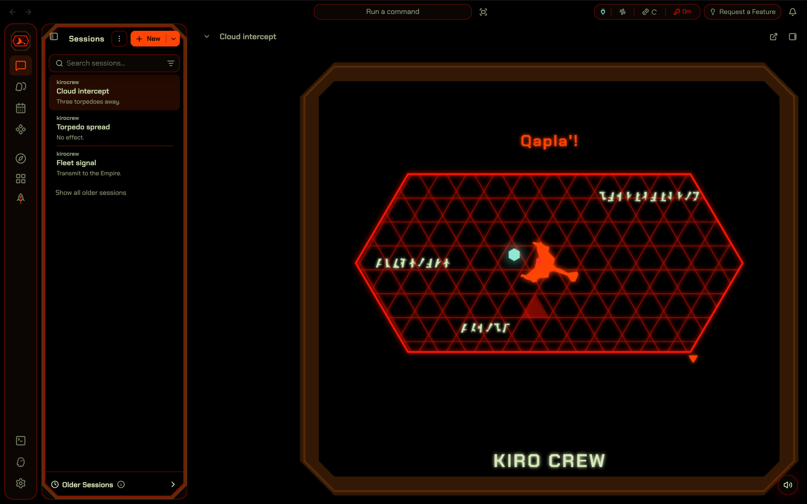
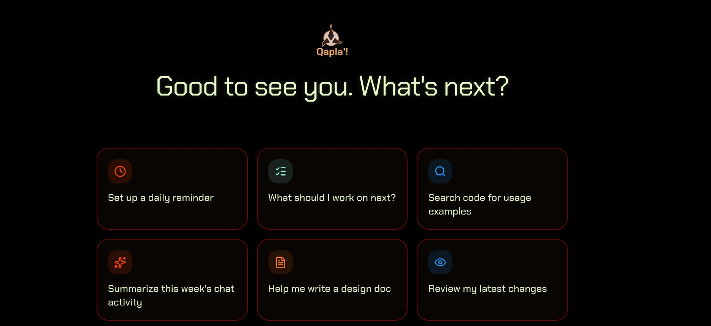

# Kiro Crew theme: Klingon · K't'inga

An unofficial Kiro Crew theme modeled on the bridge of the Klingon K't'inga-class battle cruisers in *Star Trek: The Motion Picture* (1979), the film's opening battle with V'Ger.

- **Look:** the bridge's tactical display. Black glass in a dim amber-brown housing with cut corners, a faint red triangle lattice behind the chat, pale glyph-coloured text, the orange of the ship symbol as the accent, the cyan-white of the contact for success, red for errors.
- **Thinking indicator:** three red torpedoes lighting in turn inside the grid.
- **Welcome mark:** the Klingon Empire emblem as the films show it, black prongs edged in gold on a pale disc ringed in gold, with the Klingon phrase *Qapla'!* ("Success!") under it. The emblem is traced from *Star Trek VI*; no frame of *The Motion Picture* shows it.
- **Screensaver:** after 15 minutes with no key press, click, scroll or touch, the tactical display fills the screen: the red lattice inside its hexagon, the orange ship symbol in a blinking target box, a cyan-white contact closing in, torpedoes leaving the ship, rows of glyphs that change, and *Qapla'!* above the grid. Press a key or click to dismiss it; the click does not reach the app. The dashboard's nav, session list and chat header stay on top, so the display fills the area to their right. It does not run when the OS is set to reduce motion, and it stops after 30 minutes.
- **Desktop splash:** while the desktop app waits for its gateway, the same display in its housing, with the app's name under the grid and *Qapla'!* above it. It holds still when the OS asks for reduced motion.
- **Code:** code blocks, diffs and the file viewer use the `synthwave-84` scheme (red, cyan, pink and yellow) in both modes.
- **Light mode:** the same as dark. The films have no light screens.
- **Type:** Chakra Petch, a free sans whose letters have cut corners, like the screen housings. The Klingon screens carry no Latin type, only Klingon glyphs, so there is no film face to match.
- **Shapes:** cut (bevelled) corners use CSS `corner-shape: bevel`, which Chrome, Edge and the desktop app draw. A browser without it shows rounded corners instead.
- **Glyphs:** the Klingon-style glyphs on the splash and the screensaver are original, made in code. They are decoration: they spell nothing, as the film graphics did not.
- **Sounds:** short, low console tones when the theme turns on or off, when a reply arrives, on notifications, and when an approval waits. Original sounds made in code, shaped after the 1979 film's electronic effects: warbling square-wave tones and falling two-note calls. None is taken from the film. They stay silent under reduced motion and while sounds are muted.

Choosing this theme turns the screensaver on. The first time you pick it, Kiro Crew asks whether to play its sounds. Turn either off later under Settings → Display → Theme → Experience (Overlays for the screensaver, Sounds for the sounds).

Needs Kiro Crew 0.13.0 or newer; older versions refuse the pack.

Pick System under Settings → Display → Font Family to keep the OS font.

| Chat | Screensaver | Desktop splash | Welcome mark | First pick |
|---|---|---|---|---|
|  |  |  |  |  |

## The two Klingon packs

| Repo | Films |
|---|---|
| This one | *Star Trek: The Motion Picture* (1979) |
| [kirocrew-theme-klingon-bird-of-prey](https://github.com/leozhad/kirocrew-theme-klingon-bird-of-prey) | *Star Trek III to VI* (1984 to 1991) |

## Install

1. Open Settings → Display → Theme.
2. Under **Install Theme**, choose **GitHub** and paste `https://github.com/leozhad/kirocrew-theme-klingon-k-tinga`.
3. Install, then pick **Klingon · K't'inga** in the Theme list.

To update, install the same URL again.

From a browser that is not on the gateway's machine (a phone, say), use a zip instead: on GitHub choose **Code → Download ZIP**, then in Install Theme set **Theme source** to **Zip file** and pick that file. Kiro Crew finds the pack inside the zip's one top-level folder.

## Use your own sounds

The sounds are WAV files in `audio/`, named in `audio/manifest.json`: `activate` and `deactivate` (the theme turns on or off), `received` (a reply arrives), `notify` (notifications) and `approval` (an approval waits). To play your own, clone or unzip this repo, replace any of those files with a sound of your own under the same name, and install that folder (**Local folder**) or a zip of it. Kiro Crew accepts WAV, MP3 or OGG; if you change the extension, change `src` in `audio/manifest.json` to match. Keep each file under 512 KB. Kiro Crew stops a sound after its `maxDuration` (at most 5 s for `activate`, 1 s for `received`, 2 s for the others). Do not edit the installed copy: reinstalling replaces it.

## Film evidence

Colours were measured on [TrekCore](https://movies.trekcore.com/gallery/) Blu-ray screencaps: the film's hue and saturation, with brightness set for contrast (body text at least 7:1, secondary text and status colours at least 4.5:1). The frames are not in this repo.

Source: theatrical 4K remaster Blu-ray (2021). Set: redesigned by Douglas Trumbull and Andrew Probert, built under art director John Vallone; graphics: Lee Cole, who credited Vallone with the edge-lit plastic displays ([Memory Alpha, K't'inga class](https://memory-alpha.fandom.com/wiki/K%27t%27inga_class)).

| Colour | Frame | What it is | Film hue, sat |
|---|---|---|---|
| lattice | 94 | the red triangle lattice of the tactical display | 4°, 0.98 |
| ship | 94 | the orange ship symbol at its centre | 15°, 0.98 |
| glyph | 94 | the pale glyph labels on the grid (near white; measured with a saturation floor of 15/255) | 84°, 0.21 |
| contact | 94 | the cyan-white hexagon contact | 165°, 0.38 |
| script | 50 | orange glyph text on the grid | 16°, 0.81 |
| bridge | 42 | the cyan-blue glyph screens on the bridge consoles | 207°, 0.86 |
| lamp | 91 | the orange ceiling lamps | 12°, 0.84 |
| housing | 94 | the dim amber-brown housing round the viewscreen (value floor 25/255) | 26°, 0.91 |

Shapes: the viewscreen housing is a wide rectangle with cut corners (50, 94). The grid is an elongated hexagon, pointed left and right (92, 94), made of equilateral triangles. The target box round the ship symbol is a smaller hexagon of the same shape (94). The contact is a hexagon with a rounded glow (94). Three torpedoes show as a row of red dots on the grid (58).

Ship symbol: the orange K't'inga symbol at the grid's centre (92), traced: the orange pixels thresholded, the outer contour taken with OpenCV and simplified to 1.2 px, 36 points, kept as vector data in units of the symbol's longer side. The frame itself is not stored.

Type: none. The screens carry only Klingon glyphs. The pack uses Chakra Petch, a free sans with cut-corner letters, chosen for the bevelled housings, not to match any film type.

Glyphs: the labels are rows of angular, blade-like symbols (50, 94). Memory Alpha says Michael Okuda has admitted that the Klingon screen graphics from *Star Trek IV* on are "randomly arranged symbols", based on the few writings in TOS and the first three films ([Memory Alpha, Klingonese](https://memory-alpha.fandom.com/wiki/Klingonese)). The pack's glyphs are original shapes in that spirit, made in code: two or three tapered wedges each, generated from a seed. None is traced from a frame, a font or pIqaD.

Emblem: not visible in this film. None shows on the K't'inga hulls (frames 18 to 28, 33, 34, 46, 47, 52 to 55, brightened; the dark marks on the command pod in 46 are hull lettering) or on the bridge (42, 50, 58, 91, 92, 94). Memory Alpha ([Klingon emblem](https://memory-alpha.fandom.com/wiki/Klingon_emblem)) says the K't'inga cruisers here carried a three-coloured emblem; no frame confirms it, so the pack draws the emblem from *Star Trek VI* (see "The emblem" below).

### The emblem

Frame: *The Undiscovered Country*, Chapter 1, frame 140 (the same graphic in 139, 147 and 150): the Klingon Empire emblem on the *Excelsior*'s viewscreen as the Klingon transmission comes in after Praxis. Memory Alpha's file "Klingon emblem.jpg" is the same shot ("The emblem of the Klingon Empire displayed on the USS Excelsior viewscreen in 2293"). It is the clearest emblem in the five films: full frame, sharp edges, flat colour.

What it shows: three separate black prongs, each with a gold edge, over a pale disc ringed in gold. The top prong is a long kite: a needle tip far above the disc, widest just below the ring, a point at the disc's centre. The lower left prong sweeps down and out to a hooked tip below the disc; the lower right prong sweeps out to the right, its tip a little above its base. The lower prongs' tips reach past the ring; their inner corners nearly meet under the top prong's point.

| Colour | What it is | Film hue, sat, value |
|---|---|---|
| prong | the black inside each prong (a warm near-black) | 5°, 0.29, 0.18 |
| gold | the prongs' edges and the ring | 31°, 0.62, 0.95 |
| disc | the pale disc | 282°, 0.08, 0.85 |

The emblem is a mark, not text, so it keeps the film's brightness as well. The build's frame check re-measures all three on the frame.

Trace: the frame was upscaled 2x and sharpened; the black was taken at half intensity between the black (value 0.18) and the gold or pale round it, and also as the dip between the two gold edges where the top prong narrows to its tip; the gold beyond the ring is everything that is not the red screen; the disc and the ring are circles fitted to the pale disc's edge and the ring's outer edge (radius 112.0 and 126.4 px, centre 886.0, 474.1). Each outline was then refitted as smooth cubic Bézier curves within 1.2 px of the trace (the top prong's left gold edge is one curve, within 1.6 px), sharp only at its corners (the prong tips, the kite's side points and the inner notches): 29 curve segments in all, where the first traced polygons had 122 points and showed the trace's bumps. The drawn prongs cover the frame's black with an IoU of 0.90 (0.91 before smoothing), and 95% of the pixels round the emblem fall in the same class (prong, gold, disc or screen) in the frame and in the drawing. The outline is kept as vector data; the frame is not stored.

Other appearances checked: *The Search for Spock*, Kruge's bridge (frames 104, 116, 117): a yellow triangular plaque on the wall with a red long prong, dark lower prongs and a green disc, as Memory Alpha describes the 2280s emblem; through the bridge haze it is too soft to trace or measure. *The Final Frontier*, frame 681: the panel above. *The Motion Picture*: none (see that section).

Both packs draw the frame-140 emblem in the frame-140 colours: no film gives the K't'inga a different one that a frame confirms.

### The phrase

*Qapla'!* ("Success!"), in Marc Okrand's spelling from *The Klingon Dictionary* (p. 171): capital Q, lowercase l, a straight apostrophe, then the exclamation mark. It sits under the emblem on the welcome mark, on each splash and on each screensaver, set in the pack's font. It is the only Klingon phrase in the packs; the new-chat greeting stays English, because Kiro Crew 0.13 gives a pack no way to change it.

Not used: the Enterprise wireframe on Kruge's monitor (III 775) is a Federation ship on a Klingon screen; the *Bounty*'s console inlays (IV 326, 331, 332) are Starfleet light-table graphics in the Klingon ship; Chang's console lamps (VI 1734, 1736, 1756) are physical buttons, not displays. The *Bounty*'s grey-brown viewport housing (IV 364, 401) matches the bronze measured in III and was not measured separately.

## Credits and licenses

See [`LICENSE.txt`](LICENSE.txt). The pack, its artwork, its glyph shapes and its sounds are MIT; the sounds are original, synthesized in code, and inspired by the films. The font, Chakra Petch, is under the SIL Open Font License 1.1.

Unofficial, non-commercial fan art. Star Trek, the Klingon emblem, the ships and related marks are trademarks of their owners (CBS Studios / Paramount). Not affiliated with or endorsed by them. This repo ships no film images and no film audio.
