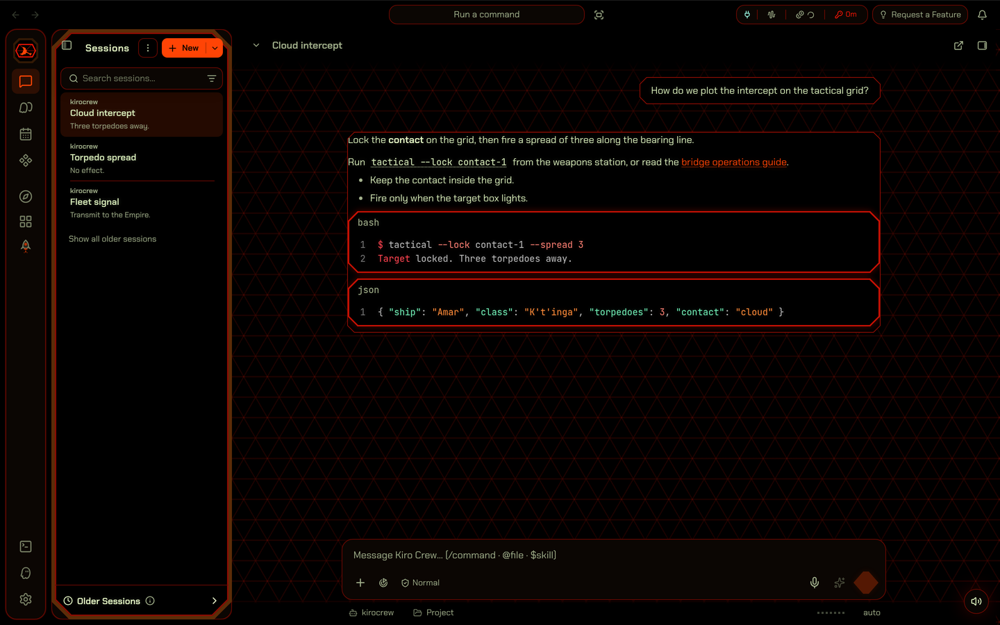
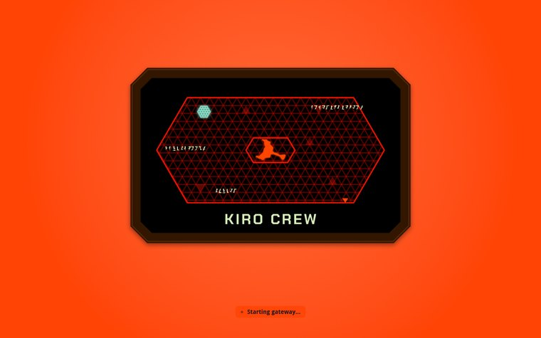

# Kiro Crew theme: Klingon · K't'inga

An unofficial Kiro Crew theme modeled on the bridge of the Klingon K't'inga-class battle cruisers in *Star Trek: The Motion Picture* (1979), the film's opening battle with V'Ger.

- **Look:** the bridge's tactical display. Black glass in a dim amber-brown housing with cut corners, a faint red triangle lattice behind the chat, pale glyph-coloured text, the orange of the ship symbol as the accent, the cyan-white of the contact for success, red for errors.
- **Thinking indicator:** three red torpedoes lighting in turn inside the grid.
- **Welcome mark:** the Klingon emblem as the K't'inga hulls carried it: a red long prong with blue and pale green arms on a yellow circle.
- **Screensaver:** after 15 minutes with no key press, click, scroll or touch, the tactical display fills the screen: the red lattice inside its hexagon, the orange ship symbol in a blinking target box, a cyan-white contact closing in, torpedoes leaving the ship, and rows of glyphs that change. Press a key or click to dismiss it; the click does not reach the app. The dashboard's nav, session list and chat header stay on top, so the display fills the area to their right. It does not run when the OS is set to reduce motion, and it stops after 30 minutes.
- **Desktop splash:** while the desktop app waits for its gateway, the same display in its housing, with the app's name under the grid. It holds still when the OS asks for reduced motion.
- **Code:** code blocks, diffs and the file viewer use the `synthwave-84` scheme (red, cyan, pink and yellow) in both modes.
- **Light mode:** the same as dark. The films have no light screens.
- **Type:** Chakra Petch, a free sans whose letters have cut corners, like the screen housings. The Klingon screens carry no Latin type, only Klingon glyphs, so there is no film face to match.
- **Shapes:** cut (bevelled) corners use CSS `corner-shape: bevel`, which Chrome, Edge and the desktop app draw. A browser without it shows rounded corners instead.
- **Glyphs:** the Klingon-style glyphs on the splash and the screensaver are original, made in code. They are decoration: they spell nothing, as the film graphics did not.
- **Sounds:** short, low console tones when the theme turns on or off, when a reply arrives, on notifications, and when an approval waits. Original sounds made in code (`tools/sounds.py`), shaped after the 1979 film's electronic effects: warbling square-wave tones and falling two-note calls. None is taken from the film. They stay silent under reduced motion and while sounds are muted.

Choosing this theme turns the screensaver on. The first time you pick it, Kiro Crew asks whether to play its sounds. Turn either off later under Settings → Display → Theme → Experience (Overlays for the screensaver, Sounds for the sounds).

Needs Kiro Crew 0.13.0 or newer; older versions refuse the pack.

Pick System under Settings → Display → Font Family to keep the OS font.

| Chat | Screensaver | Desktop splash | Welcome mark | First pick |
|---|---|---|---|---|
|  |  |  |  |  |

## The two Klingon packs

| Repo | Films |
|---|---|
| This one | *Star Trek: The Motion Picture* (1979) |
| [kirocrew-theme-klingon-bird-of-prey](https://github.com/leozhad/kirocrew-theme-klingon-bird-of-prey) | *Star Trek III to VI* (1984 to 1991) |

## Install

1. Open Settings → Display → Theme.
2. Under **Install Theme**, choose **GitHub** and paste `https://github.com/leozhad/kirocrew-theme-klingon-k-tinga`.
3. Install, then pick **Klingon · K't'inga** in the Theme list.

To update, install the same URL again.

From a browser that is not on the gateway's machine (a phone, say), use a zip instead: on GitHub choose **Code → Download ZIP**, then in Install Theme set **Theme source** to **Zip file** and pick that file. Kiro Crew finds the pack inside the zip's one top-level folder.

## Use your own sounds

The sounds are WAV files in `audio/`, named in `audio/manifest.json`: `activate` and `deactivate` (the theme turns on or off), `received` (a reply arrives), `notify` (notifications) and `approval` (an approval waits). To play your own, clone or unzip this repo, replace any of those files with a sound of your own under the same name, and install that folder (**Local folder**) or a zip of it. Kiro Crew accepts WAV, MP3 or OGG; if you change the extension, change `src` in `audio/manifest.json` to match. Keep each file under 512 KB. Kiro Crew stops a sound after its `maxDuration` (at most 5 s for `activate`, 1 s for `received`, 2 s for the others). Do not edit the installed copy: reinstalling replaces it.

## Film evidence

Colours were measured on [TrekCore](https://movies.trekcore.com/gallery/) Blu-ray screencaps: the film's hue and saturation, with brightness set for contrast (body text at least 7:1, secondary text and status colours at least 4.5:1). The frames are not in this repo.

Source: theatrical 4K remaster Blu-ray (2021). Set: Harold Michelson; graphics: Lee Cole, who introduced the edge-lit plastic displays ([Memory Alpha, K't'inga class](https://memory-alpha.fandom.com/wiki/K%27t%27inga_class)).

| Colour | Frame | What it is | Film hue, sat |
|---|---|---|---|
| lattice | 94 | the red triangle lattice of the tactical display | 4°, 0.98 |
| ship | 94 | the orange ship symbol at its centre | 15°, 0.98 |
| glyph | 94 | the pale glyph labels on the grid (near white; measured with a saturation floor of 15/255) | 84°, 0.21 |
| contact | 94 | the cyan-white hexagon contact | 165°, 0.38 |
| script | 50 | orange glyph text on the grid | 16°, 0.81 |
| bridge | 42 | the cyan-blue glyph screens on the bridge consoles | 207°, 0.86 |
| lamp | 91 | the orange ceiling lamps | 12°, 0.84 |
| housing | 94 | the dim amber-brown housing round the viewscreen (value floor 25/255) | 26°, 0.91 |

Shapes: the viewscreen housing is a wide rectangle with cut corners (50, 94). The grid is an elongated hexagon, pointed left and right (92, 94), made of equilateral triangles. The target box round the ship symbol is a smaller hexagon of the same shape (94). The contact is a hexagon with a rounded glow (94). Three torpedoes show as a row of red dots on the grid (58).

Ship symbol: the orange K't'inga symbol at the grid's centre (92), traced: the orange pixels thresholded, the outer contour taken with OpenCV and simplified to 1.2 px, 36 points, kept in `tools/splash.py` in units of the symbol's longer side. The frame itself is not stored.

Type: none. The screens carry only Klingon glyphs. The pack uses Chakra Petch, a free sans with cut-corner letters, chosen for the bevelled housings, not to match any film type.

Glyphs: the labels are rows of angular, blade-like symbols (50, 94). Michael Okuda has said the Klingon screen graphics from *Star Trek IV* on "are randomly arranged symbols" based on the few writings in TOS and the first three films ([Memory Alpha, Klingonese](https://memory-alpha.fandom.com/wiki/Klingonese)). The pack's glyphs (`tools/glyphs.py`) are original shapes in that spirit: two or three tapered wedges each, generated from a seed. None is traced from a frame, a font or pIqaD.

Emblem: not visible on the K't'inga bridge in the frames checked. Memory Alpha ([Klingon emblem](https://memory-alpha.fandom.com/wiki/Klingon_emblem)) says the K't'inga hulls in this film carried the three-coloured variant: a red long prong, with the second prong blue and the third pale green, on a yellow circle. The pack's welcome mark and favicon draw that: red and blue are the measured `lattice` and `bridge` colours; the yellow disc and the green arm are not measured on a frame.

## Credits and licenses

See [`LICENSE.txt`](LICENSE.txt). The pack, its artwork, its glyph shapes and its sounds are MIT; the sounds are original, synthesized in code, and inspired by the films. The font, Chakra Petch, is under the SIL Open Font License 1.1.

Unofficial fan art. Star Trek, the Klingon emblem, the ships and related marks belong to their owners (CBS Studios / Paramount). Not affiliated with or endorsed by them. This repo ships no film images and no film audio.
